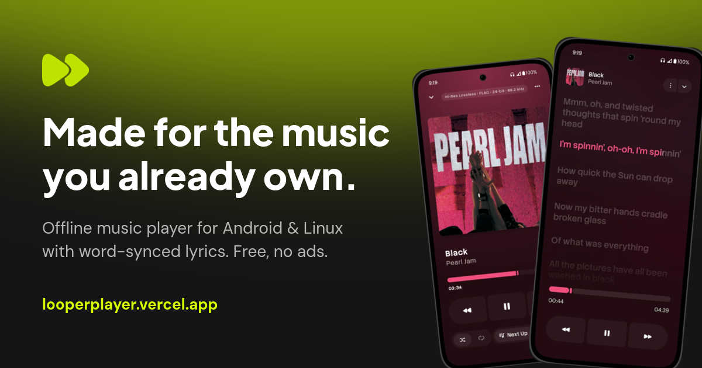
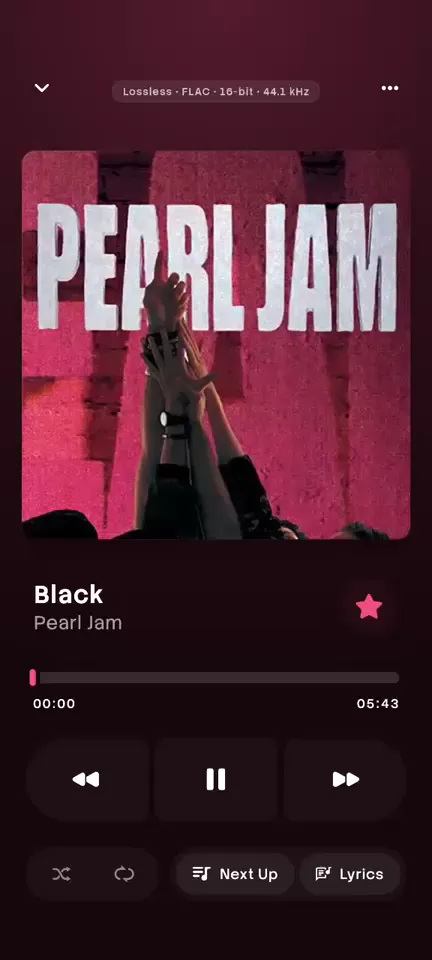
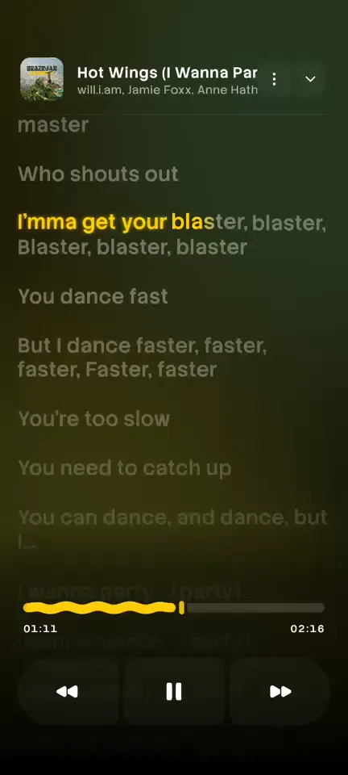
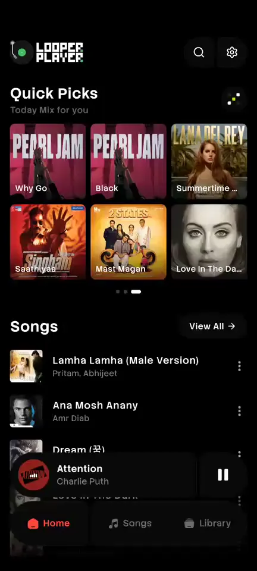
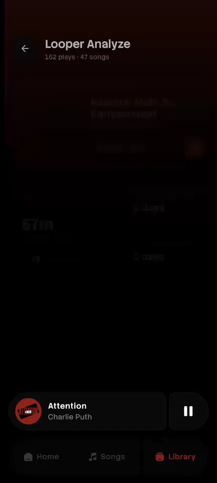
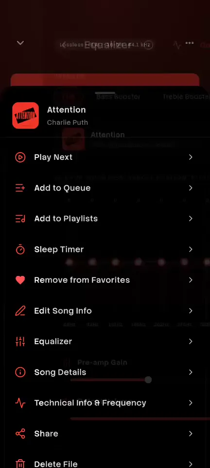

<p align="center">
  
</p>

<h3 align="center">The website for Looper Player — a music player that makes your own collection feel new again.</h3>

<p align="center">
  Live word-synced lyrics, real app recordings and colours that move. Built with React, Vite and Tailwind.
</p>

<p align="center">
  <a href="https://looperplayer.vercel.app"></a>
  
  
  
  
</p>

<p align="center">
  <a href="https://looperplayer.vercel.app"><b>Visit the site</b></a> •
  <a href="https://github.com/sthrnilshaaa/looper">The app on GitHub</a> •
  <a href="https://play.google.com/store/apps/details?id=com.looper.player">Google Play</a> •
  <a href="#getting-started">Run it locally</a>
</p>

<p align="center">
  <a href="https://looperplayer.vercel.app"></a>
</p>

---

## What's on the site

<p align="center">
  
  
  
  
  
</p>

- **A lyrics player you can try.** Not a video: word-by-word and line-by-line sync, tap a line to jump,
  scrub the progress bar, and watch the background take the colours of each track.
- **The real app, moving.** Five phones and a laptop play actual screen recordings of Looper on Android
  and Linux.
- **A glow that changes colour.** The half-circle behind the header sweeps clockwise through album colours.
- **Every feature at a glance.** Album-colour themes, the 18-band EQ, lyric search, 12 widgets,
  Looper Analyze, backups and 14 languages, each with its own small animation.
- **One-tap downloads.** Google Play, the APK, and Linux `.deb` / `.rpm` / `.tar.gz` with copyable
  install commands.
- **Fast and light.** No animation library, no analytics, no cookies. Lazy media, clips that pause off
  screen, and full `prefers-reduced-motion` support.
- **Works everywhere.** From a 360px phone to a wide desktop, with a mobile menu and no sideways scrolling.

## About Looper Player

[Looper](https://github.com/sthrnilshaaa/looper) is a free, open-source offline music player for Android and
Linux. It plays the music files you already own, with word-synced lyrics, album-colour themes, an 18-band
equalizer, listening stats and home-screen widgets. No account, no ads, no tracking.

<p>
  <a href="https://play.google.com/store/apps/details?id=com.looper.player">
    
  </a>
</p>

---

## Tech stack

- [Vite 8](https://vite.dev) + [React 19](https://react.dev) + TypeScript
- [Tailwind CSS v4](https://tailwindcss.com) (design tokens in `@theme`)
- Self-hosted fonts via `@fontsource-variable` (Manrope for headings, DM Sans for everything else)
- [oxlint](https://oxc.rs/docs/guide/usage/linter) for linting
- No animation library: all motion is CSS plus a few small React hooks

<a id="getting-started"></a>
## Getting started

**Requirements:** Node.js `^20.19` or `>=22.12` (a Vite 8 requirement) and npm.

```bash
npm install
npm run dev        # dev server with hot reload → http://localhost:5173
```

| Command           | What it does                                                             |
| ----------------- | ------------------------------------------------------------------------ |
| `npm run dev`     | Start the dev server                                                     |
| `npm run build`   | Type-check (`tsc -b`) and build the production site into `dist/`         |
| `npm run preview` | Serve the production build locally                                       |
| `npm run lint`    | Lint the source with oxlint                                              |
| `npm run screens` | Rebuild the app screenshots from the app repo (see [Images](#images))    |
| `npm run videos`  | Re-cut the screen-recording clips in `public/clips` (see [Images](#images)) |
| `npm run og`      | Rebuild `public/og.png`, the link-preview image                          |
| `npm run assets`  | Rebuild the logo, decoration and favicon from `design/`                  |

## Page sections

| Section              | Component(s)                         | Notes                                                        |
| -------------------- | ------------------------------------ | ------------------------------------------------------------ |
| Header               | `Header.tsx`, `HeroGlow.tsx`         | Section links on wide screens, a menu button below 1024px; turns solid after the hero. The top glow sweeps clockwise to a new colour every few seconds |
| Hero                 | `Hero.tsx`, `CtaRow.tsx`             | Headline, 10K+ downloads badge, highlights, animated EQ      |
| Screens              | `ShowcaseTabs.tsx`, `MobileCarousel.tsx`, `DesktopShowcase.tsx`, `Clip.tsx` | Real screen recordings: 5 phones in CSS phone frames (~4 s each) and a CSS laptop with Linux clips (5–8 s each). A slide moves on when its clip ends; hovering loops it; clips pause when scrolled away |
| Stats                | `Stats.tsx`                          | Numbers count up when scrolled into view                     |
| Lyrics (`#lyrics`)   | `LyricsShowcase.tsx`                 | A working copy of the lyrics screen (see below)              |
| Features (`#features`) | `Features.tsx`                     | Bento grid with a small animation per card + languages strip |
| Looper Analyze       | `Analyze.tsx`                        | Phone screenshot + animated sample stat cards                |
| Download (`#download`) | `Download.tsx`                     | Play Store, APK, and Linux .deb / .rpm / .tar.gz with copyable install commands |
| Privacy (`#privacy`) | `Privacy.tsx`                        | No account, no ads, no tracking, open source                 |
| Videos, FAQ, Support | `Community.tsx`                      | YouTube videos, FAQ accordion, Ko-fi / GitHub / Telegram, contributors |
| Footer               | `Footer.tsx`                         | All links real; GPL-3.0 note                                 |

### The lyrics demo

`LyricsShowcase.tsx` runs a real player: a clock driven by `requestAnimationFrame`, three demo tracks
with **original lyrics** (no copyrighted songs), and word timings generated per line. It shows what the
app does:

- **Word by word / Line by line** toggle, the app's two sync styles
- **Tap a line** to seek to it, click the progress bar to scrub
- **♫ intro dots** before the first line
- **Elastic follow**: rows near the active line move first and farther rows trail behind
- **Colours from the artwork**: the blurred background blobs and accent change with each track

The clock pauses when the demo is off screen.

## Links and copy

Every external link and the shared copy live in **[`src/config.ts`](src/config.ts)**:

| Key                 | Points to                                                     |
| ------------------- | ------------------------------------------------------------- |
| `playStore`         | Google Play listing                                           |
| `releases`          | GitHub latest release (APK + Linux packages)                  |
| `linuxDownload`     | The on-page `#download` section (header penguin button)       |
| `github`            | Source repository                                             |
| `issues`            | GitHub issues                                                 |
| `contribute`        | Contributing section of the app README                        |
| `contributors`, `contributorsImage` | Contributors graph and the contrib.rocks avatar image |
| `privacy`           | The on-page `#privacy` section                                |
| `licenses`          | `LICENSE.md` (GPL-3.0) in the app repo                        |
| `kofi`, `telegram`  | Ko-fi page and Telegram group                                 |

`COPY.badge` is the hero badge text. `10K+` is the GitHub release download total
(10,796 on 2026-10-14). Update it when the number grows.

Full `http(s)` links open in a new tab (`rel="noreferrer"`); `#` links scroll within the page.

## SEO

`index.html` has the title, meta description and keywords, a canonical URL, Open Graph and Twitter card
tags (with `public/og.png`, 1200×630), and `SoftwareApplication` JSON-LD. `public/robots.txt` and
`public/sitemap.xml` point search engines at the site. If the domain changes, update it in
`index.html`, `robots.txt`, `sitemap.xml`, `scripts/og-image.sh` and `LINKS.site`.

## Project structure

```
.
├── index.html                  # entry HTML: SEO meta, Open Graph, JSON-LD
├── public/                     # favicon.png, og.png, robots.txt, sitemap.xml
│   └── clips/                  # m-*.mp4 (phone) and d-*.mp4 (desktop) recordings + .webp posters
├── scripts/
│   ├── prep-screens.sh         # app screenshots → src/assets/shots/*.webp
│   ├── prep-videos.sh          # screen recordings → public/clips/*.mp4
│   ├── og-image.sh             # builds public/og.png
│   └── prep-assets.sh          # logo, decoration, favicon from design/
└── src/
    ├── main.tsx, App.tsx       # app shell and section order
    ├── index.css               # Tailwind, design tokens, hero glow, all keyframes
    ├── config.ts               # links + shared copy
    ├── hooks/useInView.ts      # IntersectionObserver hook + reduced-motion check
    ├── assets/                 # logo, decoration, linux icon
    │   └── shots/              # phone-*.webp and desk-*.webp app screenshots
    └── components/
        ├── Reveal.tsx          # scroll-reveal wrapper + shared section heading
        ├── Header.tsx, Hero.tsx, CtaRow.tsx
        ├── ShowcaseTabs.tsx, MobileCarousel.tsx, DesktopShowcase.tsx, FloatingMarks.tsx
        ├── Stats.tsx, LyricsShowcase.tsx, Features.tsx, Analyze.tsx
        ├── Download.tsx, Privacy.tsx, Community.tsx, Footer.tsx, Logo.tsx
        └── icons/              # Google Play and Play + GitHub badge icons as inline SVG
```

## Design notes

- **Tokens** (`src/index.css`, `@theme`): page background `#151515`, logo lime `#C0E200`,
  badge lime `#D8FF00`, olive surfaces `#1E2015`, cards `#181818`, all sampled from the design file.
- **Hero glow:** two stacked radial gradients fitted to pixels sampled from the design. Radii are in
  `vw`, so the glow scales with the viewport.
- **Motion:** scroll reveals (`Reveal`), count-ups, the lyrics player, card micro-animations, a
  languages marquee and auto-advancing screenshots. Everything respects `prefers-reduced-motion`:
  animations stop, reveals show immediately, and carousels don't auto-advance.
- **Accessibility:** `tablist`/`tab`/`tabpanel` roles on the switchers, a radiogroup for the sync style,
  carousel and slide semantics with a polite live region, native `<details>` for the FAQ, visible focus
  rings, and alt text on every screenshot.
- **Responsive:** fluid from 1440px down to phone widths with no horizontal scroll.

<a id="images"></a>
## Images

Screenshots are built from the app repo's `media/` folder (default `../looper_player/media`):

```bash
npm run screens                      # or: bash scripts/prep-screens.sh /path/to/looper/media
```

The phone screenshots are 1080×1920 renders of a phone on a dark backdrop. The script crops to the
phone body, cuts the rounded corners out with an alpha mask, and saves WebP. Desktop screenshots are
resized to 1600px wide. Requires ImageMagick 7 (`magick`) with WebP support.

`npm run videos` cuts the looping clips in `public/clips/` (H.264 MP4 + WebP poster each) from the
promo project's recordings (default `../looper_showcase/captures`). Phone clips are 432×960, desktop
clips 1600×874, the same ratio as the laptop screen in `DesktopShowcase.tsx`, so nothing is letterboxed.
Needs `ffmpeg` with `libopenh264` and `libwebp`.

`npm run og` rebuilds the link preview from those screenshots, the logo and the app's fonts
(`../looper_player/assets/fonts`).

The original Figma exports live in a local, **git-ignored** `design/` folder; `npm run assets` only
needs them for the logo, decoration and favicon.

## Deployment

The site is static and deployed on Vercel. Build command: `npm run build`; output directory: `dist`.
Any static host works (Netlify, Cloudflare Pages, GitHub Pages, …).

If you host under a sub-path such as `https://<user>.github.io/<repo>/`, set the base path in
`vite.config.ts` first:

```ts
export default defineConfig({
  base: '/<repo>/',
  plugins: [react(), tailwindcss()],
})
```

## Contributing

Spotted a typo, a broken link or a layout bug? Open an [issue](https://github.com/sthrnilshaaa/looper/issues)
or send a pull request. Run `npm run lint` and `npm run build` first, and check the page at phone width.

## Credits

* **Nilesh Suthar** — development
* **Karan Suthar** — design

## Support

Looper is free and open source. If you enjoy it, star the [app repo](https://github.com/sthrnilshaaa/looper),
share it, or support us on Ko-fi:

<a href="https://ko-fi.com/L2L124TL7L">
  
</a>

## License

The app is licensed under [GPL-3.0](https://github.com/sthrnilshaaa/looper/blob/main/LICENSE.md).
This website repo doesn't have its own `LICENSE` file yet.

## Contact

Say hi on Telegram:

[](https://t.me/looperPlayer)
